<picture>
  <source media="(prefers-color-scheme: dark)" srcset="./dark.svg">
  <source media="(prefers-color-scheme: light)" srcset="./light.svg">
  
</picture>

 

### Hi, I'm Aditya

Student and developer, learning in public. I use this profile as a working notebook — everything here is built while I learn, not after I've mastered it.

---

### Focus

| | |
|:--|:--|
| **Right now** | Building fundamentals: programming, the web, and problem solving |
| **Approach** | Small projects, read the source, ship something every week |
| **Interested in** | Software engineering, web development, and how systems are put together |
| **Looking for** | Collaboration on beginner-friendly open source, and honest code review |

---

### Stack I'm learning with

" srcset="https://github-readme-stats.vercel.app/api">
  <source media="(prefers-color-scheme: light)" srcset="https://github-readme-stats.vercel.app/api">
  
</picture>

<picture>
  <source media="(prefers-color-scheme: dark)" srcset="https://streak-stats.demolab.com">
  <source media="(prefers-color-scheme: light)" srcset="https://streak-stats.demolab.com">
  
</picture>

 

<picture>
  <source media="(prefers-color-scheme: dark)" srcset="https://github-readme-stats.vercel.app/api/top-langs/">
  <source media="(prefers-color-scheme: light)" srcset="https://github-readme-stats.vercel.app/api/top-langs/">
  
</picture>

---

### Projects

I'm early in the journey, so there's no highlight reel yet. As repositories get published, they'll appear here with a one-line description each. Until then, the pinned repositories on my profile are the real state of things.

---

### Connect

[![GitHub](https://img.shields.io/badge/GitHub-181717
[![Instagram](https://img.shields.io/badge/Instagram-E4405F
[![Email](https://img.shields.io/badge/Email-EA4335

Banner built as self-contained SVG — halftone portrait, SMIL animation only, no external assets, no JavaScript. Switch your GitHub theme and it follows you.

